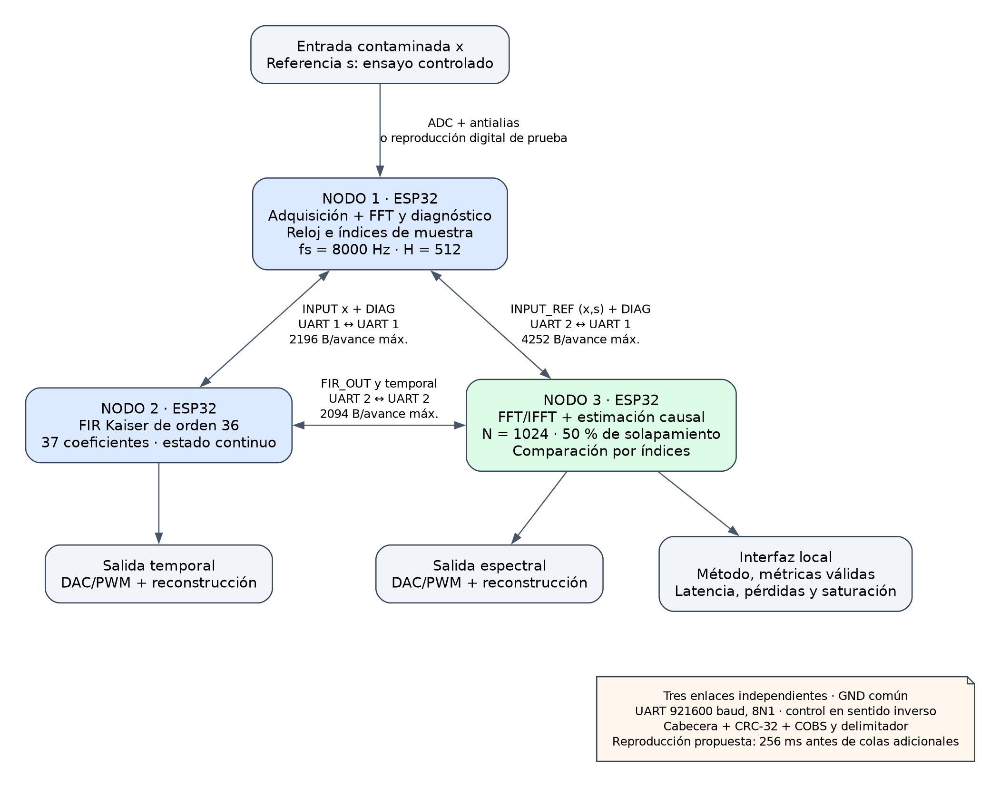

# Arquitectura de tres nodos y comunicación

**Estado:** arquitectura y protocolo propuestos, cálculos y trama de
ejemplo verificados en PC. No se han probado enlaces ni plazos en placa.
Se mantienen fs = 8000 Hz, N = 1024, H = 512 y float32 para DSP.

## Distribución funcional

Se proponen **tres ESP32 clásicos separados** y tres enlaces UART
punto a punto. Así la adquisición queda separada y las dos rutas
producen salidas físicas independientes, como exige el proyecto.

La [versión SVG](figuras/arquitectura_nodos.svg) conserva la resolución al ampliar el diagrama.

| Nodo | Responsabilidad | Datos que conserva o produce |
|---|---|---|
| N1: adquisición y análisis | Adquirir x con antialias, normalizar escala, fijar reloj e índices, realizar FFT y diagnóstico causal | Lotes de 512 muestras nuevas, diagnóstico resumido y referencia s cuando exista |
| N2: filtrado temporal | Recibir x, ejecutar FIR Kaiser de 37 coeficientes con estado continuo, reproducir salida | y_FIR sin compensación artificial de índices; salida digital enviada a N3 |
| N3: espectral y evaluación | Recibir la misma x, calcular FFT/IFFT y máscaras causales, reproducir salida, comparar por índices | y_espectral, referencia y FIFO de y_FIR; métricas y estado en pantalla/interfaz local |

N1 calcula diagnóstico para cumplir su función de análisis. N3 calcula
localmente las máscaras a partir de x y del historial descrito en el [diseño de procesamiento](2_5_diseno_esp32.md); no necesita recibir todas las FFT o un piso de 513 valores.
El resumen de N1 sirve para visualizar y contrastar detección y parámetros.
En N1 el piso de diagnóstico se aproxima con una mediana local de 31
bins de la trama actual, tras quitar su DC medio; no almacena el
historial de ocho tramas propio del filtro de N3.
La máscara no se calcula a partir de la referencia limpia. N2 tampoco
recibe s durante el filtrado.

Las salidas DAC/PWM requieren escala, limitación de rango y filtrado
analógico de reconstrucción. La computadora sirve para programar,
guardar evidencia y validar; las rutas principales y la comparación
controlada se ejecutan en los microcontroladores.

## Enlaces físicos

| Conexión | Puertos propuestos | Sentido principal | Retorno |
|---|---|---|---|
| N1–N2 | UART1 de N1 ↔ UART1 de N2 | x y diagnóstico | Estado y control |
| N1–N3 | UART2 de N1 ↔ UART1 de N3 | x, s opcional y diagnóstico | Control del ensayo y estado |
| N2–N3 | UART2 de N2 ↔ UART2 de N3 | y_FIR | Control y estado |

Se propone **921600 baud, 8N1, full duplex**, con TX cruzado a RX y
GND común en un banco de cables cortos y niveles lógicos de 3.3 V.
UART0 queda disponible para programación y registros. El ESP32 tiene
tres controladores UART y ESP-IDF permite configurar baud, formato,
pines y buffers mediante su driver
([guía oficial UART](https://docs.espressif.com/projects/esp-idf/en/stable/esp32/api-reference/peripherals/uart.html)).
Los GPIO concretos se elegirán al conocer placa, ADC/DAC y pantalla,
sin ocupar pines ya usados por otros periféricos. Se verificará la tasa
efectiva con `uart_get_baudrate` y medición del enlace.

Los tres enlaces funcionan en paralelo; no se propone un único bus
compartido al que se deba sumar todo el tráfico. N1 debe encolar las
copias de x en ambos UART sin esperar a que una transmisión termine
para iniciar la otra. El diagnóstico se envía después del lote de datos
y puede corresponder a la ventana anterior, identificada por su índice.
Su cálculo no debe retrasar el envío de muestras.

## Referencia y significado de las métricas

En ensayos digitales, N1 reproduce x y s de un caso guardado en flash,
con una configuración de escala común e índices idénticos. En adquisición
analógica, s requiere un canal de referencia tomado antes de añadir
ruido, con reloj común, ganancia y desfase caracterizados. Esa adquisición
de dos canales depende de los convertidores elegidos y no se presupone
resuelta por tener una UART. El transporte contempla ambos modos.

Con s disponible y válida, N3 calcula MSE, SNR de entrada/salida y ΔSNR
sobre índices comunes. Para el FIR, s[n] se compara con y_FIR[n+18];
se esperan las muestras necesarias del siguiente lote. No se alinea
por el momento en que llega un paquete ni se optimiza el desfase con
la referencia. La escala de reproducción DAC se reporta aparte.

Para **energía útil conservada** en el ensayo controlado, se propone un
modo de diagnóstico adicional en N3: aplicar a s la secuencia de G
aprendida de x, sin reestimar el piso, con DC y overlap-add propios;
también filtrar s con una instancia FIR local. Así se obtiene y_util y
el residual condicional `y_ruido = y − y_util`, siguiendo el criterio
del evaluador. Este modo añade otra FFT e IFFT por avance y estado
adicional, incluidos en el presupuesto de N3. El objetivo de 48 ms
debe medirse con ese modo activado si se muestran esas métricas.

La atenuación total puede acumularse con r = x−s y los residuales
alineados. Una atenuación de banda calculada con ventanas cortas se
etiquetará como estimación por trama; no se confundirá con la medición
Hann de 8174 muestras del informe. Reproducir exactamente esa medición
larga requiere una validación separada, no presupuestada aquí.

Sin referencia limpia se envía solo x y la interfaz muestra energía
total, diagnóstico, latencia y pérdidas; MSE, SNR respecto de s y
energía útil se indican **N/D**. El cociente E_salida/E_entrada no se
rotula como conservación de energía útil. El intervalo de calentamiento
y cualquier discontinuidad se distinguen en las métricas.

## Protocolo binario propuesto

Cada paquete se construye como **cabecera de 32 bytes + payload + CRC-32
de 4 bytes**. Después se codifica con COBS y se añade un delimitador
`0x00`. Los enteros y float32 se serializan en little endian; las
muestras usan formato IEEE 754 binary32, valores finitos y escala
normalizada común. No se envía una estructura C con su padding.

| Offset | Campo | Tamaño | Significado |
|---:|---|---:|---|
| 0 | magic | 2 B | 0x5341; bytes 41 53 |
| 2 | version | 1 B | Versión del protocolo: 1 |
| 3 | type | 1 B | 1 INPUT, 2 INPUT_REF, 3 FIR_OUT, 4 DIAG, 5 CONTROL |
| 4 | src | 1 B | Nodo emisor 1, 2 o 3 |
| 5 | dst | 1 B | Nodo receptor |
| 6 | flags | 2 B | Referencia válida, calentamiento, reinicio, saturación o discontinuidad |
| 8 | session_id | 4 B | Identificador común del ensayo; cambia al reiniciar |
| 12 | sequence | 4 B | Contador de paquetes por sentido de enlace, módulo 2³² |
| 16 | first_sample | 8 B | Índice de la primera muestra real del payload/ventana asociada |
| 24 | sample_count | 2 B | 512 para muestras; 0 para mensajes sin muestras |
| 26 | format | 1 B | 1 float32; 0 metadatos |
| 27 | channels | 1 B | 1 para x o y; 2 para x,s; 0 metadatos |
| 28 | payload_bytes | 4 B | Longitud a validar antes de copiar |

Los flags propuestos son 0x0001 referencia válida, 0x0002 calentamiento,
0x0004 reinicio, 0x0008 saturación, 0x0010 discontinuidad y
0x0020 ventana inicial parcial. En INPUT_REF se intercalan
`x[0], s[0], x[1], s[1], …`; ambas rutas reciben exactamente los mismos
bytes float32 de x. FIR_OUT conserva los índices de y causal; el retardo
de 18 muestras se interpreta desde la configuración.

DIAG tiene 64 bytes: fs(u32), N(u16), H(u16), método(u8), estado de
calentamiento(u8), reservado(u16), pico_Hz(f32), banda_lo(f32),
banda_hi(f32), piso_resumen(f32), DC(f32), energía de entrada(f32),
tiempo de análisis_us(u32), overruns(u32), pérdidas(u32), saturaciones(u32),
inicio de ventana(u64) y config_id(u32). `piso_resumen` es el RMS de las
magnitudes del piso estimado de N1, en unidades de su FFT sin normalizar;
es diagnóstico, no el vector de piso utilizado por N3. Las bandas y pico
ausentes usan −1.0 y un estado explícito, no valores no finitos.

CONTROL tiene 32 bytes: fs(u32), N(u16), H(u16), método(u8),
opcode(u8), status(u16), config_id(u32), índice efectivo(u64) y
8 bytes reservados. Opcode: 1 CONFIG, 2 START, 3 STOP, 4 STATUS,
5 ACK. Una configuración compartida identifica además coeficientes,
parámetros de reducción y escala; config_id remite a esa configuración
preinstalada, cuya huella se valida al preparar el ensayo. Los cambios
se acuerdan para un índice futuro y se aplican tras ACK de ambos filtros.

El CRC propuesto es **CRC-32/ISO-HDLC**, polinomio 0x04C11DB7,
refin/refout verdaderos, init y xorout 0xFFFFFFFF; la comprobación de
`123456789` da 0xCBF43926. Se calcula sobre cabecera y payload antes
de COBS y se transmite little endian. La variante se contrastó con
`zlib.crc32` en PC ([manual de zlib](https://zlib.net/manual.html),
[implementación del proveedor](https://github.com/madler/zlib/blob/v1.3.1/crc32.c)).

COBS evita que el delimitador aparezca dentro del paquete codificado.
Para dimensionar se usa la cota conservadora
`B_wire ≤ B_raw + floor(B_raw/254) + 2`, incluidos byte de código y
delimitador. Se verificaron sus límites con datos de ceros y no ceros
([Cheshire y Baker, COBS](https://stuartcheshire.org/papers/COBSforToN.pdf)).

## Bytes y tasa mínima

Cada avance contiene 512 muestras nuevas, no las 1024 de la ventana
completa: el receptor conserva el solapamiento. El protocolo transmite
float32 para mantener la referencia numérica propuesta; un transporte
int16 podría reducir tráfico, pero añadiría cuantización que debe medirse.

| Paquete | Payload | Cabecera + payload + CRC | Máximo en el cable con COBS |
|---|---:|---:|---:|
| INPUT o FIR_OUT | 2048 B | 2084 B | 2094 B |
| INPUT_REF | 4096 B | 4132 B | 4150 B |
| DIAG | 64 B | 100 B | 102 B |
| CONTROL | 32 B | 68 B | 70 B |

Con 8N1 se transmiten 10 bits por byte. Para un avance cada 64 ms,
`baud_min = B_wire × 10 / 0.064`. Se dimensiona un DIAG por avance,
aunque el diagnóstico efectivo pueda actualizarse con menor frecuencia.

| Sentido de enlace | Bytes máximos por avance | Baud mínimo sostenido | Ocupación a 921600 |
|---|---:|---:|---:|
| N1→N2: INPUT + DIAG | 2196 B | 343125 | 37.23 % |
| N1→N3 con s: INPUT_REF + DIAG | 4252 B | 664375 | 72.09 % |
| N1→N3 sin s: INPUT + DIAG | 2196 B | 343125 | 37.23 % |
| N2→N3: FIR_OUT | 2094 B | 327187.5 | 35.50 % |

Se reserva hasta **10 CONTROL por segundo y por sentido**, con ráfaga
máxima de uno por avance: añaden 7000 baud promedio. El enlace más
exigente requiere entonces **671375 baud**, ocupación **72.85 %**;
921600 proporciona margen. 115200 resulta insuficiente, incluso para
una ruta de muestras. Estos mínimos no incluyen retransmisiones
ilimitadas, cambios arbitrarios de formato ni ventanas FFT completas.

## Sincronización, errores y latencia

N1 fija session_id, fs y contador de muestras. Ambos receptores usan
esos índices como reloj lógico. N3 mantiene FIFO de referencia y salida
FIR de **4H = 2048 muestras** cada una y compara únicamente sesiones,
configuraciones e índices coincidentes. El reloj de reproducción debe
seguir la tasa de N1: usar un reloj común o ajustar lentamente la tasa
de DAC/PWM según la ocupación de la cola. Los índices por sí solos no
impiden deriva entre relojes físicos independientes.

Al recibir se delimita por cero, decodifica COBS, valida CRC, magic,
versión, destino, longitud, formato y valores finitos. Un salto de
sequence indica paquetes omitidos; first_sample y sample_count determinan
si faltan muestras o solo diagnóstico. Duplicados y paquetes antiguos
se descartan. Un bloque inválido nunca se incorpora al historial DSP.
Limitar paquetes a 4150 bytes codificados con delimitador evita copiar
una longitud arbitraria; ante exceso se descarta hasta el próximo cero.

No se retransmiten bloques de audio vencidos. Se registra el hueco,
marca el intervalo inválido, aplica silencio o una transición controlada
en reproducción y reinicia los estados dependientes del tramo faltante.
La máscara vuelve a calentarse. Los comandos de configuración sí requieren
ACK y reintento acotado antes de empezar el ensayo. La interfaz registra
CRC incorrectos, huecos, cola desbordada, saturación y reinicios. Los
eventos de FIFO/ring buffer y trama del driver UART complementan el CRC.

Se propone un retardo de reproducción de **256 ms (4H/fs)** para incluir adquisición, procesamiento y enlaces. Bajo el objetivo T_DSP ≤ 48 ms, un control
adicional por avance y lanzamiento TX ≤ 1 ms por enlace, el modelo sitúa
la disponibilidad espectral a **223.90 ms** desde la primera muestra.
El FIR alineado que necesita 18 muestras del lote siguiente estará
disponible en N3 aproximadamente a **226.07 ms**. Ambos valores dejan
margen hasta 256 ms si no hay otra cola o pausa.

Estos tiempos son un cálculo de planificación: las transmisiones deben
solaparse con adquisición/DSP y las tareas UART deben atender buffers
mientras se filtra. El retardo de grupo FIR sigue siendo 2.25 ms; la
reproducción de y causal incluye ese efecto aunque se programe una cola
común. Se verificará latencia extremo a extremo mediante una marca o
impulso y registros locales; las marcas de tiempo de placas distintas
no se restan sin sincronizar sus relojes.

## Memoria por dispositivo

La comunicación y evaluación controlada requieren recursos adicionales
al [DSP aislado](2_5_bibliotecas_esp32.md). Se conservan sus tablas y buffers y se añaden
colas, parser, driver y estado de evaluación, sin cargar las capturas
completas en RAM.

| Nodo | Total provisional | Objetivo de reserva | Margen de diseño |
|---|---:|---:|---:|
| N1 | 72868 B, 71.16 KiB | 96 KiB | 25436 B |
| N2 | 46652 B, 45.56 KiB | 64 KiB | 18884 B |
| N3, con referencia y energía útil condicional | 137377 B, 134.16 KiB | **160 KiB** | 26463 B |

N3 añade dos FIFO de 8192 B, parsers de 4132 y 2084 B, dos buffers
CONTROL de 70 B, historial DC de s y OLA útil de 4096 B cada uno,
y un FIR de referencia de 352 B estimados. Su reserva auxiliar de
40960 B contempla RX UART de 8192 B por enlace, TX de 2048 B por
enlace, pilas de 8192 B, DMA de 8192 B, colas de 2048 B y otros
2048 B. Los datos originales de x y s pueden consumirse por lotes
desde flash en la prueba digital.

N1 y N2 reservan 32768 B auxiliares cada uno: 12288 B de UART, 8192 B de pilas, 8192 B de DMA, 2048 B de colas y 2048 B para otros datos.
Se dimensionan buffers acotados y tareas de recepción separadas del DSP;
una función que tarda 48 ms no puede bloquear el vaciado del UART.
La reserva de **96 KiB corresponde a la ruta espectral aislada**:
no basta para el nodo completo con referencia y evaluación. La nueva
cuenta es una provisión, no un mapa de RAM libre ni una garantía de
cabida; falta medir memoria, pilas, jitter y tiempos del firmware real.

## Evidencia y comprobación pendiente

El formato se comprobó en PC mediante serialización de una cabecera, CRC conocido, límites COBS, reconstrucción de la carga y detección de un bit alterado. Estas comprobaciones validan el formato propuesto, sin demostrar todavía un enlace físico.

En placa se comprobarán el tráfico simultáneo de los tres enlaces,
recepción con fragmentación, pérdidas/corrupción introducidas, deriva de
relojes, RAM y cumplimiento de 64 ms por avance con evaluación activa.
Los índices y la referencia permitirán contrastar las métricas con la
implementación de PC. La arquitectura y los cálculos se redactaron con
asistencia de IA; no se presentan como firmware ya implementado.
