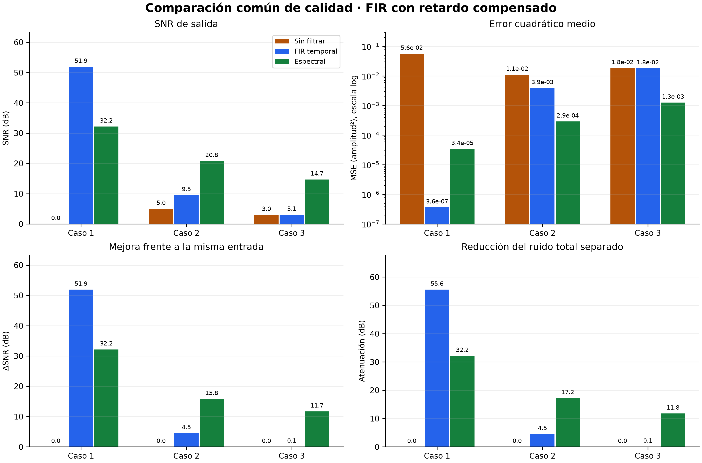

# 2.5 Comparación y propuesta para el sistema embebido

Este documento explica la comparación de los filtros sobre las tres capturas de prueba. El diseño de ESP32, las bibliotecas y la comunicación se describen en los documentos complementarios enlazados al final.

## Objetivo

Comparar la entrada sin filtrar, el FIR temporal y la salida espectral en
los tres casos oficiales. Justificar las decisiones para el sistema embebido
mediante resultados medidos y un presupuesto de procesamiento, memoria y
comunicación.

## Metodología común

La configuración reproducible está en [metadatos/protocolo.json](../entrega/tarea1/metadatos/protocolo.json). Las instrucciones para ejecutarla están en el [README](../entrega/tarea1/README.md).

La comparación principal compensa las 18 muestras del FIR y utiliza
8174 muestras comunes. También se informan las métricas directas.
La energía útil se separa del ruido residual mediante una evaluación
condicional con ganancias espectrales fijadas desde la mezcla.

El módulo [evaluar_comparacion.py](../entrega/tarea1/src/evaluar_comparacion.py) calcula las métricas. El [CSV](../entrega/tarea1/resultados/metricas.csv) y el [JSON](../entrega/tarea1/resultados/resultados_2_5.json) conservan las mediciones citadas en el informe.

## Resultados comparativos

Las cuatro tablas y sus unidades están en el [resumen de resultados](../entrega/tarea1/resultados/resumen_2_5.md). Las figuras muestran señales, PSD, error, energía útil, ganancias por tono y recursos en PC.

| Caso | SNR entrada (dB) | SNR FIR (dB) | SNR espectral (dB) |
|---|---:|---:|---:|
| 1: tonal separada | 0.010 | 51.911 | 32.166 |
| 2: blanco | 5.009 | 9.524 | 20.813 |
| 3: superposición parcial | 3.010 | 3.071 | 14.677 |

La revisión numérica comparó CSV y JSON y recalculó las métricas desde los NPZ.

La figura del caso 1 muestra que ambos filtros atenúan la componente de
2150 Hz; el FIR alcanza menor error global. En el caso 2, el FIR conserva
parte del ruido dentro de su banda de paso, mientras la reducción espectral
reduce el error más ampliamente. En el caso 3, el FIR deja casi intacto el
ruido entre 900 y 1300 Hz, que se superpone con el tono útil de 1100 Hz.

La conservación de energía útil es alta en todos los casos: el FIR alcanza
99.643 %, y el espectral 100.000 %, 99.016 % y 99.764 %, respectivamente.
Estos porcentajes corresponden a las fuentes separadas con ganancias fijas,
no a la energía total de la salida. No demuestran ausencia de distorsión.

Los gráficos de recursos describen implementaciones diferentes en PC: FIR
manual con bucles Python y espectral vectorizado con NumPy. La comparación
de esos tiempos no determina cuál será más rápido en ESP32. La propuesta para firmware se presenta en los documentos complementarios; falta implementarla y medirla en placa.

## Elección del método por caso

La elección siguiente prioriza menor MSE y mayor SNR respecto de la señal
limpia, sobre el intervalo común con retardo compensado. En ese intervalo,
ambas métricas producen la misma clasificación porque la referencia y su
energía son iguales para todos los métodos. No se elige por energía total
de salida, que puede aumentar por el ruido residual.

| Caso | Método preferido para calidad | MSE FIR | MSE espectral | Ventaja del ganador en SNR | MSE del perdedor / ganador |
|---|---|---:|---:|---:|---:|
| 1: interferencia tonal de 2150 Hz | FIR pasa bajos | 3.629 × 10⁻⁷ | 3.422 × 10⁻⁵ | 19.745 dB | 94.30 |
| 2: ruido blanco | Espectral, resta con protección tonal | 3.887 × 10⁻³ | 2.889 × 10⁻⁴ | 11.290 dB | 13.46 |
| 3: ruido entre 900 y 1300 Hz | Espectral, resta con protección tonal | 1.813 × 10⁻² | 1.252 × 10⁻³ | 11.606 dB | 14.48 |

Estas conclusiones describen las tres capturas y configuraciones evaluadas.
No constituyen una garantía para cualquier señal o nivel de ruido.

### Caso 1: separación entre banda útil e interferencia

Los tonos útiles de 300, 700 y 1100 Hz quedan dentro de la banda de paso
del FIR, mientras la interferencia de 2150 Hz queda por encima de su borde
de rechazo de 1800 Hz. Esa separación permite reducir el ruido sin eliminar
los tonos útiles. El FIR mejora la SNR en 51.901 dB, conserva 99.643 % de
la energía útil y atenúa 64.971 dB la interferencia en la banda de
2130–2170 Hz. Las ganancias de los tres tonos están entre −0.018 y
+0.007 dB, por lo que la distorsión de amplitud observada es pequeña.

El espectral con detección de picos también funciona: mejora la SNR en
32.156 dB y conserva prácticamente toda la energía útil. Sin embargo,
su menor distorsión útil no compensa el mayor ruido residual global.
La atenuación de 59.259 dB en la banda de interferencia no equivale a la
atenuación total de ruido de 32.156 dB: son mediciones diferentes, y la
primera incorpora la ponderación de una ventana Hann en el análisis.

Un diagnóstico exploratorio de las salidas guardadas sitúa el 98.983 %
de la energía de error espectral en las primeras y últimas 512 muestras
del intervalo común, que representan 12.528 % de dicho intervalo.
Esto evidencia una concentración del error en los extremos. La cadena de
ventanas, relleno y reconstrucción es una explicación posible; atribuir
el error a una operación específica requeriría un experimento adicional.
No se eliminan esos extremos ni se modifica la clasificación principal.
El diagnóstico se obtuvo de las salidas guardadas en los NPZ de comparación.

### Caso 2: ruido distribuido dentro y fuera de la banda útil

El FIR reduce el ruido blanco fuera de su banda de paso, pero deja pasar
gran parte del que comparte banda con la señal. Por eso mejora la SNR
solamente 4.514 dB, aunque conserva los tonos útiles. Su energía total de
salida equivale al 111.400 % de la energía limpia; el excedente no es
una mejora de la señal, sino que incluye ruido residual y términos cruzados.

La resta espectral estima el piso de ruido y atenúa bins según su relación
con ese piso, con protección de tonos estables. Alcanza una mejora de SNR
de 15.804 dB y una atenuación total de ruido de 17.222 dB. La diferencia
entre estas dos cifras muestra que eliminar ruido también puede introducir
distorsión útil. Conserva 99.016 % de energía útil; sus ganancias a
300, 700 y 1100 Hz son −0.027, −0.041 y −0.079 dB, respectivamente.
El compromiso observado favorece al espectral por su menor error total.

### Caso 3: superposición con el tono útil de 1100 Hz

El ruido de 900–1300 Hz coincide con la banda de paso y con uno de los
tonos útiles. El FIR mejora la SNR apenas 0.061 dB y atenúa 0.053 dB
el ruido de esa banda: conserva la señal, pero también la interferencia.
Reducir el corte o introducir un rechazo alrededor de 1100 Hz afectaría
al tono que debe conservarse.

La resta espectral aprovecha la estructura de tonos estables para proteger
sus bins mientras reduce el piso de ruido en otros bins. Mejora la SNR
11.667 dB y atenúa 11.282 dB el ruido de 900–1300 Hz. La conservación
útil de 99.764 % y la ganancia de −0.083 dB del tono de 1100 Hz indican
un compromiso favorable en esta captura, aunque persiste ruido residual.
La protección no separa de forma perfecta las dos fuentes en los bins
que comparten: ambas reciben la misma ganancia una vez fijada la máscara.

## Compromiso entre reducción y distorsión

La conservación de energía útil debe leerse junto con MSE y ganancias por
tono. Un valor cercano a 100 % puede coexistir con errores de fase,
transitorios o una redistribución de amplitudes. Tampoco debe confundirse
con la energía total de salida.

La evaluación condicional permite escribir, para cada salida,
`y = y_util + y_ruido`. El error es
`e = (s − y_util) − y_ruido`; por tanto, el MSE incluye distorsión útil,
ruido residual y un término cruzado. No es correcto sumar únicamente
las dos energías y asumir que siempre son independientes. En el método
espectral, esta descomposición usa ganancias aprendidas desde la mezcla
y después congeladas; no entrega al filtro las referencias limpias ni
representa una separación de fuentes disponible en el firmware.

El experimento adicional de 2.4 con ruido blanco y protección tonal
desactivada muestra el riesgo de aumentar la reducción indiscriminadamente:

| Factor de resta α | SNR de salida (dB) | Atenuación fuera de los tonos (dB) | Ganancia del tono de 1100 Hz (dB) |
|---|---:|---:|---:|
| 2 | 16.938 | 20.616 | −2.707 |
| 3 | 14.737 | 25.852 | −4.277 |
| 8 | 7.643 | 25.984 | −15.582 |

Entre α = 2 y α = 8, la atenuación adicional se obtiene a costa de una
pérdida importante del tono útil y una SNR menor. Este experimento se
evalúa sobre **8192 muestras y sin protección tonal**; no se mezcla con
la comparación principal de 8174 muestras. La configuración elegida para
los casos 2 y 3 mantiene α = 3 y protección tonal activada. El experimento se reproduce con [evaluar_casos.py](../entrega/tarea1/pruebas/filtrado_espectral/evaluar_casos.py); sus nuevas salidas se guardan en `resultados/regenerados/espectral/`.

## Condiciones de fallo y alcance

| Método | Condición | Efecto y evidencia |
|---|---|---|
| FIR pasa bajos | Ruido dentro de la banda de paso | Reducción limitada en el caso 2 y prácticamente nula en el caso 3. |
| FIR pasa bajos | Contenido útil fuera de la banda prevista | Se atenuaría junto con el ruido; es una consecuencia del diseño, no una prueba realizada con otra señal. |
| Detección espectral de picos | Interferencia dentro de 0–1200 Hz o ruido distribuido | La banda protegida impide rechazar esos picos y un detector de máximos no elimina un piso ancho. En 2.4, usar picos en los casos 2 y 3 deja la SNR aproximadamente en 5 y 3 dB, respectivamente, en la evaluación directa original. |
| Resta espectral | Factor de resta excesivo o protección insuficiente | Puede eliminar señal útil; el experimento anterior lo mide al desactivar la protección. |
| Resta espectral con protección | Ruido que coincide con tonos protegidos | Parte del ruido se conserva junto con esos tonos; el caso 3 mantiene ruido residual pese a mejorar la SNR. |
| Estimación espectral actual | Señales útiles variables, ruido no estacionario o interferencias estables dentro de la banda útil | La detección de estabilidad y la mediana de captura pueden confundir fuentes o estimar mal el ruido. Es un riesgo del algoritmo que requiere capturas adicionales; no se ha medido aquí. |

El fundamento del límite del FIR es la superposición de los sistemas LTI:
si `x = s + r`, entonces `Y(f) = H(f)S(f) + H(f)R(f)`. Una misma
respuesta en frecuencia actúa sobre ambas fuentes; no distingue su origen
cuando coinciden en frecuencia. Oppenheim y colaboradores desarrollan
superposición y filtrado en las secciones 1.6.6 y 3.8–3.9; Proakis y
Manolakis describen las bandas de paso y rechazo en la sección 5.4.1
[R1–R2]. La estrategia espectral añade supuestos sobre estabilidad y piso
de ruido; su adaptación completa no es un sistema LTI, aunque el operador
condicionado a una máscara fija sea lineal.

La compensación de 18 muestras permite comparar fidelidad del FIR, pero
su retardo físico de 2.25 ms a 8000 Hz sigue existiendo. Las métricas
directas documentan el desfase; no deben sustituir la comparación alineada
para juzgar solamente el filtrado. Por su parte, la cadena espectral
utiliza información de toda la captura para estimar ruido y estabilidad,
por lo que sus resultados actuales no validan un procesamiento causal.

Las mediciones de PC muestran el espectral más rápido y con mayor pico
de memoria trazada que el FIR manual. El FIR usa bucles Python y el
espectral operaciones vectorizadas de NumPy; esos tiempos no establecen
la velocidad relativa en ESP32. El valor de cero bytes persistentes del
espectral describe su función por captura, no un requisito de RAM nulo.
La adaptación causal y el presupuesto de memoria deben validarse con ESP-DSP y mediciones en placa.

Solo se evalúa una captura con una semilla por caso, tres tonos conocidos,
un muestreo y un conjunto de parámetros. No se ha comprobado robustez con
voz, música, variaciones de nivel, frecuencias cercanas a los bordes,
otros ruidos o cambios de precisión. Estas pruebas quedan fuera de las tres capturas evaluadas.

## Conclusión comparativa

Para las condiciones medidas, conviene el FIR cuando la interferencia está
claramente separada de la banda útil, y la resta espectral con protección
cuando el ruido está distribuido o se superpone parcialmente con tonos
estables. El caso 3 demuestra el límite de un pasa bajos fijo; el
experimento sin protección demuestra el límite de una reducción espectral
agresiva. La selección debe considerar conjuntamente fidelidad, retardo,
memoria y disponibilidad de una estimación causal del ruido.

## Documentación complementaria

- [Procesamiento para ESP32](2_5_diseno_esp32.md): muestreo, bloques, formato numérico y estimación causal.
- [Bibliotecas DSP](2_5_bibliotecas_esp32.md): versiones, licencias, FFT/IFFT y FIR.
- [Arquitectura y comunicación](2_5_arquitectura_comunicacion.md): nodos, paquetes, tasas y memoria completa.

## Fuentes

- A. V. Oppenheim, A. S. Willsky y S. H. Nawab, *Señales y sistemas*, segunda edición, secciones 1.6.6, 3.8 y 3.9 [R1].
- J. G. Proakis y D. G. Manolakis, *Digital Signal Processing*, cuarta edición, sección 5.4.1 [R2].
- Mediciones reproducibles de [resultados/](../entrega/tarea1/resultados/) y código incluido en [src/](../entrega/tarea1/src/).

Las mediciones se realizaron en PC. Las prestaciones del firmware propuesto todavía deben comprobarse en ESP32.
