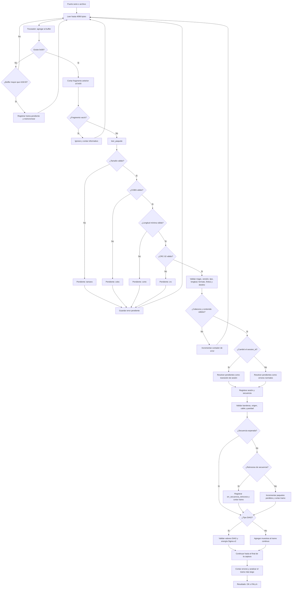
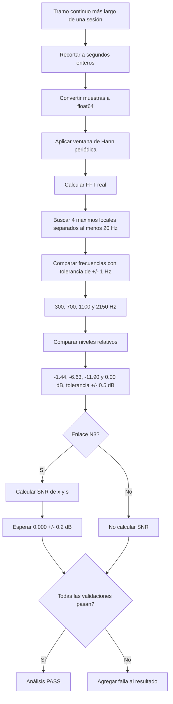
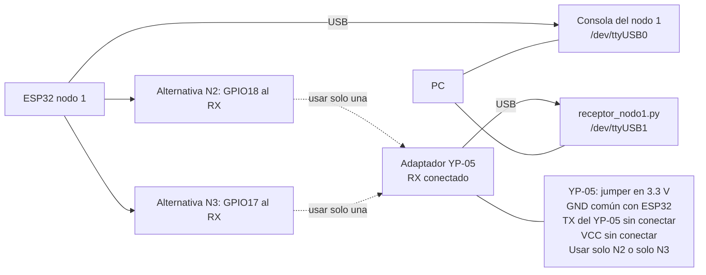
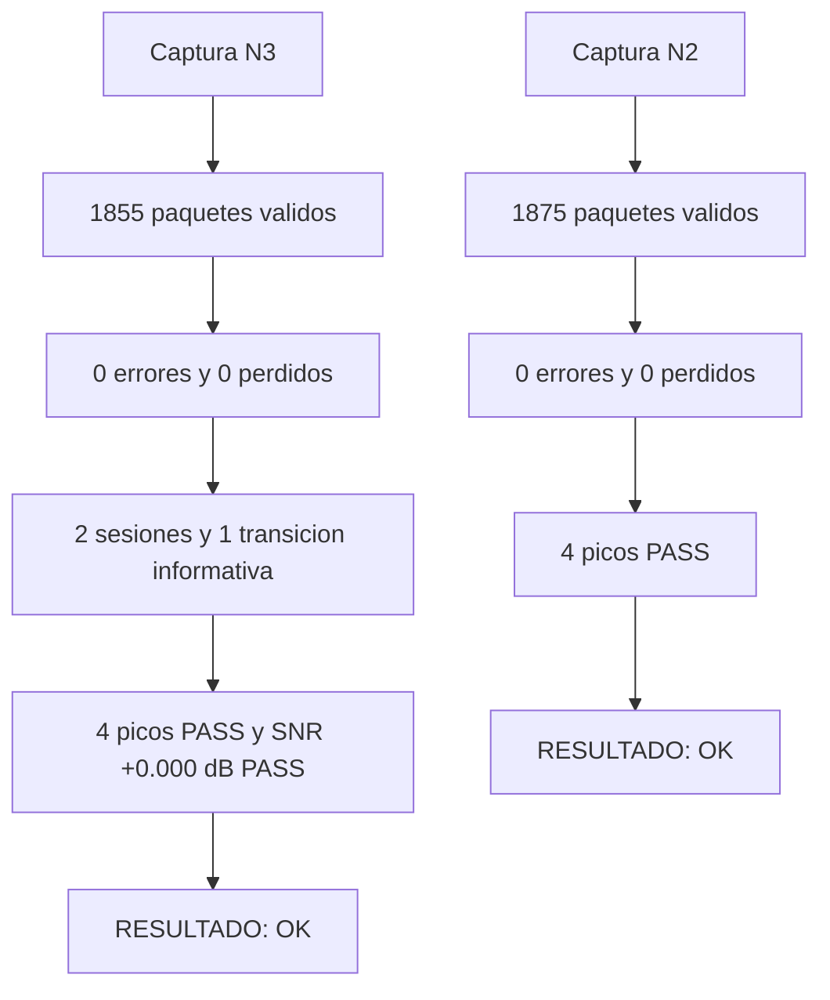

# Diagramas de validación del receptor


Estos diagramas documentan la validación en la PC del receptor del nodo 1. Se usaron las capturas reales `captura_n2.bin` y `captura_n3.bin`, sin depender de la simulación ni de la placa durante el reprocesamiento.

## 1. Flujo de recepción y validación



Los errores de tamaño, COBS, trama, longitud mínima y CRC quedan pendientes hasta recibir un paquete válido. Si el `session_id` cambió, se registran como `errores_transicion_sesion`; de lo contrario, se suman a los errores que cuentan en la evaluación final.

La secuencia valida que cada paquete avance en uno. Un salto incrementa `paquetes_perdidos` y corta el tramo continuo; un retroceso genera `err_secuencia_retroceso` y también corta el tramo. Los datos ocupan secuencias pares y DIAG secuencias impares. Una sesión nueva debe comenzar con `sequence = 0` para conservar la bandera de reinicio `0x0004`.

## 2. Validación del contenido



Los niveles relativos se comparan con una tolerancia de ±0.5 dB. En N3, el SNR se calcula como:

$$
SNR = 10\log_{10}\left(\frac{\sum s^2}{\sum (x-s)^2}\right)
$$

## 3. Montaje de prueba



Se prueba un solo enlace a la vez. Para N2 se conecta GPIO18 al RX del YP-05 y se selecciona
`--enlace n2`; para N3 se usa GPIO17 y se selecciona `--enlace n3`. Las
conexiones GPIO18 y GPIO17 son alternativas, no simultáneas. Las capturas
documentadas aquí se procesaron desde archivo, por lo que no fue necesario
montar el circuito.

## 4. Resultados de las capturas




| Enlace | Paquetes validos | Errores | Perdidos | Sesiones | Transiciones | Picos | SNR | Resultado |
|---|---:|---:|---:|---:|---:|---|---:|---|
| N3 | 1855 | 0 | 0 | 2 | 1 | 300, 700, 1100 y 2150 Hz exactos | +0.000 dB | OK |
| N2 | 1875 | 0 | 0 | 1 | 0 | 300, 700, 1100 y 2150 Hz exactos | N/D | OK |

En N3, la primera sesion fue observada a medias y la segunda comenzo desde `sequence = 0`. El reinicio con EN se recupero correctamente. En N2 no se calcula SNR porque el enlace transporta solamente `INPUT`, sin referencia `s`.

## Salida completa: N3

Comando ejecutado:

```text
python proyecto1/herramientas_pc/receptor_nodo1.py --archivo proyecto1/herramientas_pc/capturas/captura_n3.bin --enlace n3
```

```text
SESIONES
  sesion 1 (0x941e4537, observada a medias): DIAG 490, INPUT_REF 489; sequence 8449..9427; perdidos 0; banderas/0x0004 OK
  sesion 2 (0x931a2ca7, observada desde su inicio): DIAG 438, INPUT_REF 438; sequence 0..875; perdidos 0; banderas/0x0004 OK

CONTADORES (cuentan para el resultado)
  err_tamano                 0
  err_cobs                   0
  err_corto                  0
  err_crc                    0
  err_trama                  0
  err_magic                  0
  err_version                0
  err_tipo                   0
  err_longitud               0
  err_formato                0
  err_no_finito              0
  err_destino                0
  err_src                    0
  err_tipo_paridad           0
  err_cable                  0
  err_banderas               0
  err_secuencia_retroceso    0
  err_primer_bloque          0
  err_first_sample           0
  err_diag                   0
  err_diag_first_sample      0
  err_energia                0
  paquetes_perdidos          0
  inicio_sesion_perdido      0

INFORMATIVOS (no cuentan para el resultado)
  fragmento_inicial (B)      4578
  tramas_vacias              0
  errores_transicion_sesion  1
  reinicios_sesion           1
  diag_sin_datos             1
  tiempo_us (min, max)       536, 564
  paquetes validos           1855

ANALISIS
  tramo analizado: 31 s (248000 muestras, de un tramo continuo de 31.30 s)
     300 Hz: pico en   300.00 Hz, nivel  -1.44 dB (esperado  -1.44 +/- 0.5)  PASS
     700 Hz: pico en   700.00 Hz, nivel  -6.63 dB (esperado  -6.63 +/- 0.5)  PASS
    1100 Hz: pico en  1100.00 Hz, nivel -11.90 dB (esperado -11.90 +/- 0.5)  PASS
    2150 Hz: pico en  2150.00 Hz, nivel  +0.00 dB (esperado  +0.00 +/- 0.5)  PASS
  SNR = +0.000 dB (esperado 0.0 +/- 0.2)  PASS

RESULTADO: OK
```

## Salida completa: N2

Comando ejecutado:

```text
python proyecto1/herramientas_pc/receptor_nodo1.py --archivo proyecto1/herramientas_pc/capturas/captura_n2.bin --enlace n2
```

```text
SESIONES
  sesion 1 (0x931a2ca7, observada a medias): DIAG 938, INPUT 937; sequence 5801..7675; perdidos 0; banderas/0x0004 OK

CONTADORES (cuentan para el resultado)
  err_tamano                 0
  err_cobs                   0
  err_corto                  0
  err_crc                    0
  err_trama                  0
  err_magic                  0
  err_version                0
  err_tipo                   0
  err_longitud               0
  err_formato                0
  err_no_finito              0
  err_destino                0
  err_src                    0
  err_tipo_paridad           0
  err_cable                  0
  err_banderas               0
  err_secuencia_retroceso    0
  err_primer_bloque          0
  err_first_sample           0
  err_diag                   0
  err_diag_first_sample      0
  err_energia                0
  paquetes_perdidos          0
  inicio_sesion_perdido      0

INFORMATIVOS (no cuentan para el resultado)
  fragmento_inicial (B)      1527
  tramas_vacias              0
  errores_transicion_sesion  0
  reinicios_sesion           0
  diag_sin_datos             1
  tiempo_us (min, max)       536, 544
  paquetes validos           1875

ANALISIS
  tramo analizado: 59 s (472000 muestras, de un tramo continuo de 59.97 s)
     300 Hz: pico en   300.00 Hz, nivel  -1.44 dB (esperado  -1.44 +/- 0.5)  PASS
     700 Hz: pico en   700.00 Hz, nivel  -6.63 dB (esperado  -6.63 +/- 0.5)  PASS
    1100 Hz: pico en  1100.00 Hz, nivel -11.90 dB (esperado -11.90 +/- 0.5)  PASS
    2150 Hz: pico en  2150.00 Hz, nivel  +0.00 dB (esperado  +0.00 +/- 0.5)  PASS

RESULTADO: OK
```
