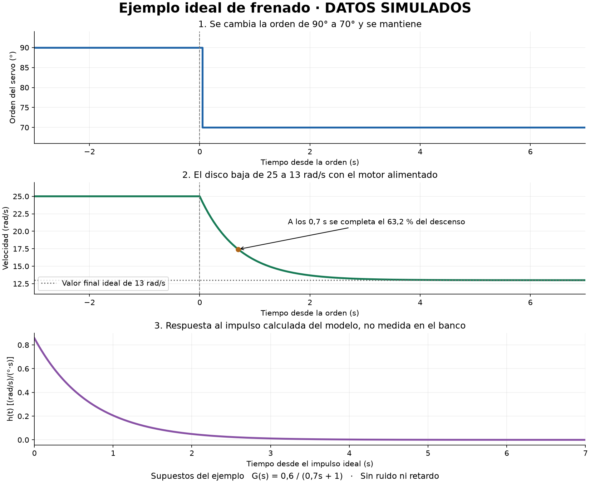

# Análisis de frenado en MATLAB

**Estado respecto al montaje real:** esta carpeta contiene el avance del compañero con ejemplos simulados y un analizador pensado para un motor alimentado a tensión constante y una velocidad final estable. Las capturas reales de la tarea se hicieron apagando la fuente antes de frenar; ambas curvas terminan en cero. El analizador de esta carpeta también espera una columna `servo_cmd_deg` o `servo_grados`, mientras que los CSV reales contienen `servo_cmd_grados`. Para las cinco capturas reales usar [el script de comparación](../analisis/analizar_capturas.m) y su [guía](../analisis/README.md). El ejemplo ideal sigue siendo útil para mostrar el método teórico; sus parámetros no son mediciones del montaje.

Este avance implementa el procesamiento previsto en [la guía de los puntos extra](../PLAN_PUNTOS_EXTRA.md). Permite ensayar el flujo con datos simulados y luego importar mediciones reales. La entrada es el ángulo ordenado al servo y la salida es la velocidad del disco. Durante este experimento se mantiene constante la alimentación del motor y no se ejecuta un PID.

## Comenzar con el ejemplo ideal

Abrir esta carpeta como carpeta actual de MATLAB y ejecutar lo siguiente en la ventana de comandos.

```matlab
close all
clear analizar_ensayo estilo_figura
ejemplo_ideal
```

Si MATLAB está en otra carpeta, abrir `ejemplo_ideal.m` y aceptar el cambio de carpeta al ejecutarlo. Las rutas de los ejemplos se calculan desde la ubicación de los scripts, de modo que no dependen de la ruta de una computadora particular.

El ejemplo supone una orden de 90 a 70 grados, velocidad inicial de 25 rad/s, ganancia de 0,6 (rad/s)/grado y constante de tiempo de 0,7 s. La velocidad final es 13 rad/s. Todos son valores hipotéticos, sin ruido ni retardo. Se supone que bajar el ángulo aumenta el frenado. El mecanismo real debe confirmar ese sentido.

Se generan las gráficas detalladas del analizador y un resumen con tres paneles. MATLAB puede agrupar las figuras en pestañas o mostrarlas en varias ventanas. La repetición de la respuesta impulsiva es intencional, porque el analizador usa el modelo ajustado y el resumen usa los parámetros originales del ejemplo. `close all` cierra las figuras abiertas de la sesión, por lo que debe omitirse si se desea conservar otras figuras.



La vista previa se generó con Python usando las mismas ecuaciones. No es una captura de MATLAB. El estilo de los scripts fija fondo claro, texto oscuro y colores de las curvas para evitar problemas de contraste con el tema oscuro.

## Archivos

| Archivo | Uso |
| --- | --- |
| `ejemplo_ideal.m` | Genera datos ideales, ejecuta el análisis y comprueba la recuperación de los parámetros. Es el primer punto de entrada. |
| `demo_simulada.m` | Ejemplo adicional con ruido y retardo conocidos. Su ejecución en MATLAB sigue pendiente. |
| `ejecutar_analisis.m` | Configuración editable para un ensayo experimental. |
| `analizar_ensayo.m` | Importación, comprobaciones, gráficas, ajuste opcional y exportación. |
| `estilo_figura.m` | Formato local de las figuras, sin cambiar las preferencias globales de MATLAB. |
| `metadatos_plantilla.md` | Información que debe acompañar cada corrida. |
| `verificacion_numerica.txt` | Comprobación matemática independiente hecha en Python. No sustituye la ejecución en MATLAB. |

## Dependencias

Se usan funciones disponibles en MATLAB R2020a o posterior. El ajuste utiliza `fminsearch`, incluido en MATLAB, y no requiere Optimization Toolbox. La ejecución del ejemplo ideal fue confirmada en la instalación del usuario. No se ha comprobado por separado la compatibilidad con todas las versiones desde R2020a.

La función `impulse` requiere Control System Toolbox. Cuando `tf` e `impulse` no están disponibles, el script genera la respuesta impulsiva mediante su expresión analítica y avisa que falta ejecutar `impulse`. Esa alternativa permite estudiar la curva, pero deja pendiente la función exigida en el enunciado. La instalación probada por el usuario no tenía disponible ese complemento.

## Recibir un ensayo real

Crear `ensayo_01` junto a los scripts y guardar `datos.csv` y `metadatos.md` en esa carpeta. Repetir con otra carpeta para cada corrida. El CSV debe contener un encabezado y filas numéricas sin mensajes de depuración.

```csv
tiempo_ms,rpm,servo_cmd_deg
```

También se acepta el nombre `servo_grados` del firmware existente. El tiempo está en milisegundos, las RPM deben ser no negativas y el ángulo es el comando enviado al servo en grados. No es una medición de la posición real ni del torque.

El registro debe cubrir varios segundos antes del cambio y suficiente tiempo después para observar un régimen final. Guardar el instante exacto `t0_ms` con el mismo reloj del CSV, no con la hora de la computadora. Si el microcontrolador se reinicia o su contador vuelve a cero, separar las corridas. El analizador rechaza tiempos repetidos o decrecientes.

Completar los metadatos con los ángulos, primer contacto, pulsos por vuelta, intervalo de registro, condiciones de alimentación y observaciones del montaje. Distinguir valores medidos y nominales. La guía pide al menos tres corridas comparables y una referencia sin contacto del freno.

## Configurar el análisis real

Editar `ejecutar_analisis.m` y cambiar la ruta del CSV y `t0_ms`. El valor inicial `NaN` evita analizar accidentalmente un instante inventado.

```matlab
archivo = fullfile(carpeta, 'ensayo_01', 'datos.csv');
t0_ms = 12345; % Solo un ejemplo. Reemplazar con el instante registrado.
opciones.tipo_datos = 'experimental';
opciones.intervalo_inicial_s = [-2 -0.2];
opciones.intervalo_final_s = [];
opciones.retardo_s = 0;
opciones.ajustar_modelo = false;
```

Primero ejecutar con el ajuste desactivado y observar las curvas. El tiempo de las ventanas es relativo a la orden, por lo que cero corresponde a `t0_ms`. La ventana inicial debe preceder a la orden y contener velocidad aproximadamente estable. La final debe estar después del transitorio. Si se deja vacía, se usa el último 20 % del tiempo posterior como propuesta inicial que debe revisarse visualmente.

Cada ventana necesita al menos cinco muestras y el tramo posterior al cambio al menos diez. Si los intervalos no tienen suficientes muestras, ampliar la captura o corregir las ventanas.

Después de revisar las curvas, activar `opciones.ajustar_modelo = true` para intentar el ajuste. `retardo_s` se fija explícitamente y no se estima. Cero es una hipótesis inicial, no una medición del retardo del servo. No se aplica filtrado automático a las RPM para no introducir otra dinámica sin documentarla.

También se puede invocar directamente la función.

```matlab
resultado = analizar_ensayo(archivo, t0_ms, opciones);
```

## Modelo e interpretación

Se emplea una aproximación local de primer orden con retardo fijo.

\[
G(s)=\frac{K e^{-Ls}}{\tau s+1}
\]

Para un cambio sostenido de orden de magnitud \(\Delta u\), la predicción es

\[
\omega(t)=\omega_0+K\Delta u\left(1-e^{-\max(t-L,0)/\tau}\right).
\]

La ganancia expresa cambios de velocidad por grado ordenado al servo. Su signo depende del montaje. En el ejemplo, tanto el ángulo como la velocidad disminuyen y por eso la ganancia es positiva. La constante de tiempo describe la rapidez de la transición y el retardo representa el tiempo previo al comienzo de la respuesta en esta aproximación.

El valor inicial de la ganancia se obtiene de la diferencia entre medias de velocidad dividida por el cambio de orden. Después se ajustan la ganancia y la constante de tiempo minimizando el error cuadrático sobre las muestras posteriores. El retardo se conserva fijo y la constante de tiempo se parametriza mediante una exponencial para que sea positiva.

La respuesta impulsiva para ese modelo es

\[
h(t)=\frac{K}{\tau}e^{-(t-L)/\tau}\,\mathbf{1}(t-L).
\]

Se calcula del modelo identificado y no corresponde a un golpe mecánico aplicado al banco. El área unitaria del impulso en la entrada se expresa en grado segundo. La curva tiene unidades de (rad/s)/(grado segundo).

Este modelo no estima masa, inercia ni torque por separado. Incluye de forma aproximada la respuesta del servo, el contacto y el disco bajo las condiciones del ensayo.

## Cuándo no aceptar el ajuste

El analizador rechaza el ajuste cuando no hay cambio suficiente de orden, la orden no es un escalón sostenido, aparecen velocidades cero, el cambio se confunde con el ruido inicial o las ventanas presentan una deriva apreciable. Esas comprobaciones son preliminares y no certifican que la planta sea lineal.

La orden gradual del firmware descrita en la guía produce una rampa y debe complementarse con una orden directa para este experimento. La transición mecánica real del servo seguirá teniendo su propia duración. Si la curva no es aproximadamente exponencial, hay saturación, se pierde contacto o el disco se detiene, revisar el experimento y considerar otro modelo en lugar de forzar este ajuste.

El intervalo de impresión tampoco equivale a información nueva del sensor. Una marca por vuelta limita la actualización real de velocidad. Imprimir más filas puede repetir una misma estimación.

El RMSE informado corresponde a las muestras usadas para ajustar. Un RMSE pequeño no demuestra validez fuera de ese ensayo. La validación con una corrida distinta sigue pendiente y no se automatiza en esta versión.

## Resultados guardados

El CSV original no se modifica. Por defecto se crea `analisis_experimental` o `analisis_simulado` junto al archivo de entrada. La opción `salida` permite elegir otra carpeta.

| Salida | Contenido |
| --- | --- |
| `entrada_y_velocidad.png` | Orden, velocidad y modelo cuando existe ajuste. |
| `datos_convertidos.csv` | Tiempo relativo, orden, RPM y rad/s. |
| `resumen.txt` y `resultado.mat` | Configuración, estado del ajuste y parámetros si se obtuvieron. |
| `impulso_analitico.png` | Respuesta impulsiva del modelo ajustado. |
| `impulse_matlab.png` | Se genera cuando la ejecución de `impulse` termina correctamente. |

El ejemplo ideal añade un resumen de tres paneles. Las salidas se sobrescriben al repetir el análisis en la misma carpeta. Usar una carpeta nueva si se desea conservar otro análisis. Las carpetas generadas por las demostraciones están excluidas de Git.

## Validación realizada

El usuario ejecutó `ejemplo_ideal` en MATLAB y obtuvo los siguientes resultados aproximados.

| Magnitud | Valor esperado | Valor obtenido |
| --- | --- | --- |
| Ganancia | 0,6 | 0,6000 |
| Constante de tiempo | 0,7 s | 0,7000 s |
| Velocidad final | 13 rad/s | 13,0032 rad/s como media de la ventana final |
| RMSE de ajuste | Cercano a cero | 0,00013748 rad/s |

La pequeña diferencia en la media final se debe a que la respuesta exponencial todavía se aproxima a su límite. También se confirmó visualmente la corrección de los colores en las figuras. Se reemplazó `range` por `max-min` para evitar una dependencia adicional detectada durante esa ejecución.

La comprobación matemática independiente en Python recuperó parámetros próximos a los usados para un ejemplo con ruido. No equivale a ejecutar `demo_simulada.m`. Todavía faltan pruebas con datos reales, validación independiente y ejecución de `impulse` con el complemento disponible.

## Relación con el video compartido

El texto del video explica medición por conteo y por periodo entre pulsos, conversión a RPM, filtrado y ajuste de un PI. No desarrolla la identificación en MATLAB ni la respuesta al impulso. Sus ganancias, encoder, relación de engranajes y filtro de 25 Hz corresponden a otro montaje. La tarea exige temporización sin `delay`, aunque el ejemplo del video sí lo utiliza.

## Pendientes para el punto extra

- Preparar el escalón y el registro temporal en el firmware junto con el equipo de hardware.
- Capturar CSV, metadatos y evidencias reales.
- Revisar la dinámica y determinar si este modelo es apropiado.
- Comparar la predicción con una corrida que no se usó para ajustar.
- Ejecutar `impulse` donde esté disponible Control System Toolbox.
- Incorporar resultados y grabar el video único con prueba física, explicación y análisis en computadora.
